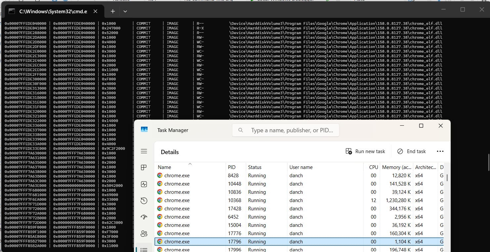
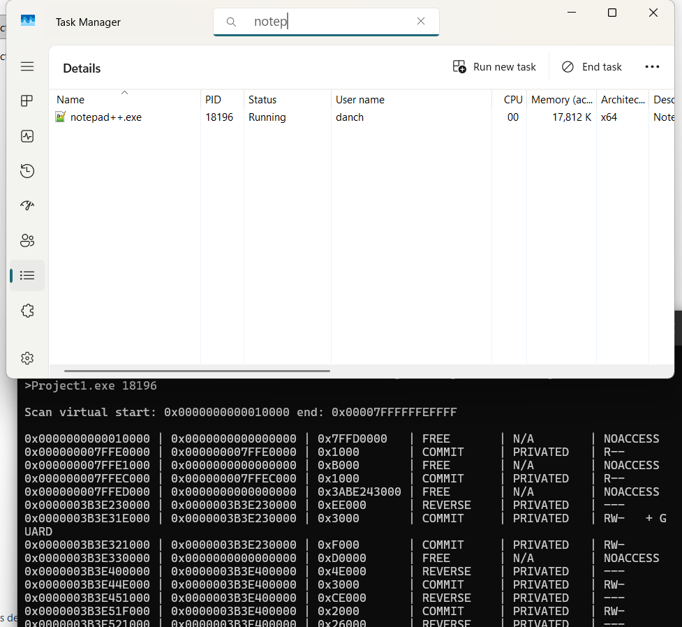
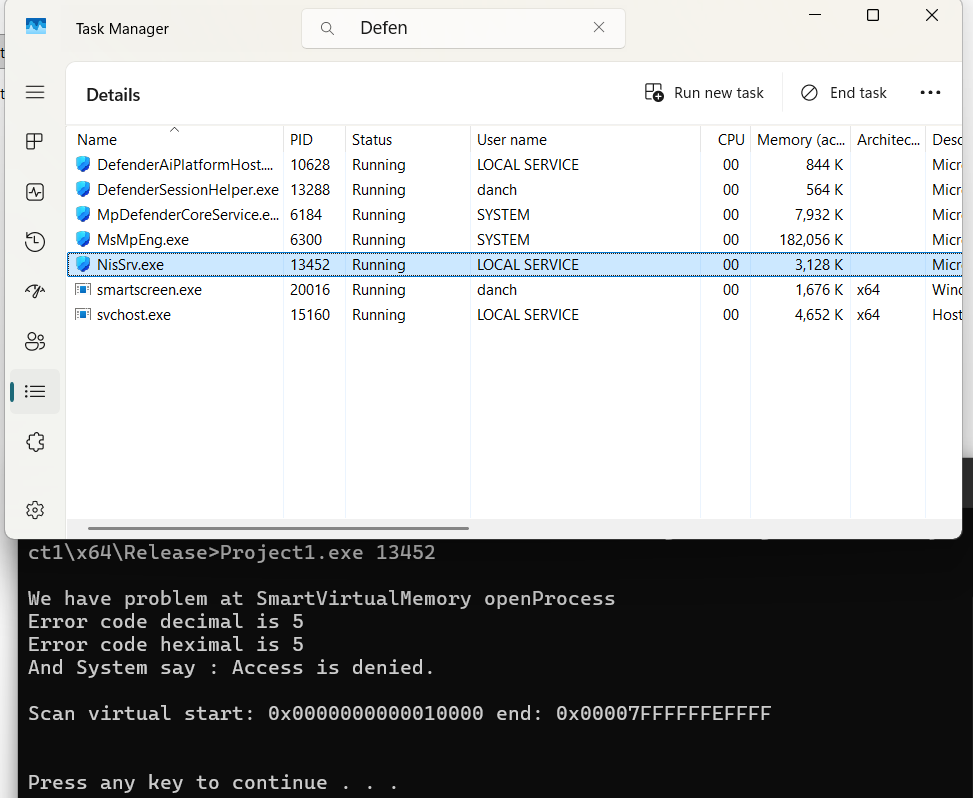

# Memory Map Scan RWX access ( like x64dbg )

&#x20; 

&#x20; 

Just a stupid homework :DD , in this shit , i used RAII handle + api VirtualQueryExW for scan remote process. Start address from 0x0000000000010000 to 0x00007FFFFFFEFFFF. Becau that space is safe , or if u wanna scan from 0x00..00 , just edit in my code at LPBYTE baseAddress.

&#x20; 

As u can see the problem , i will find solution in future XD ! 